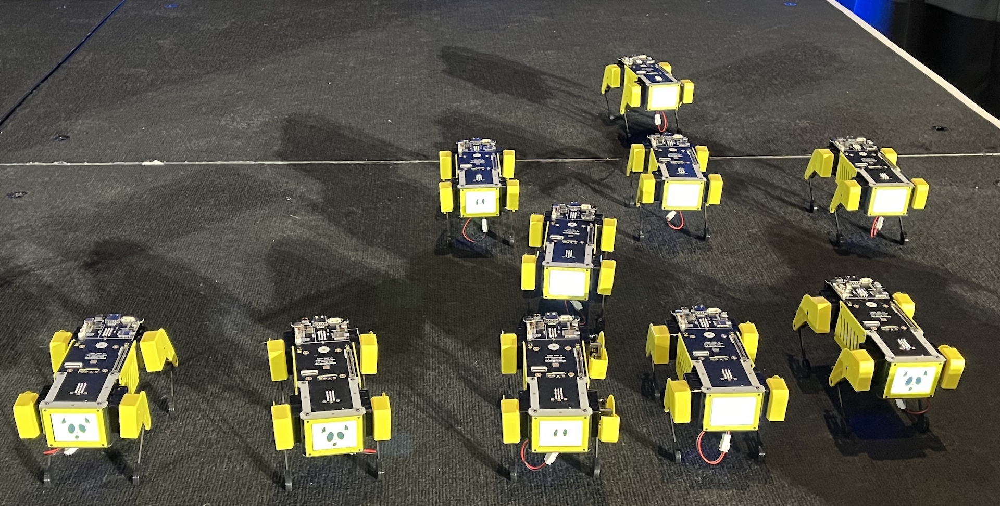
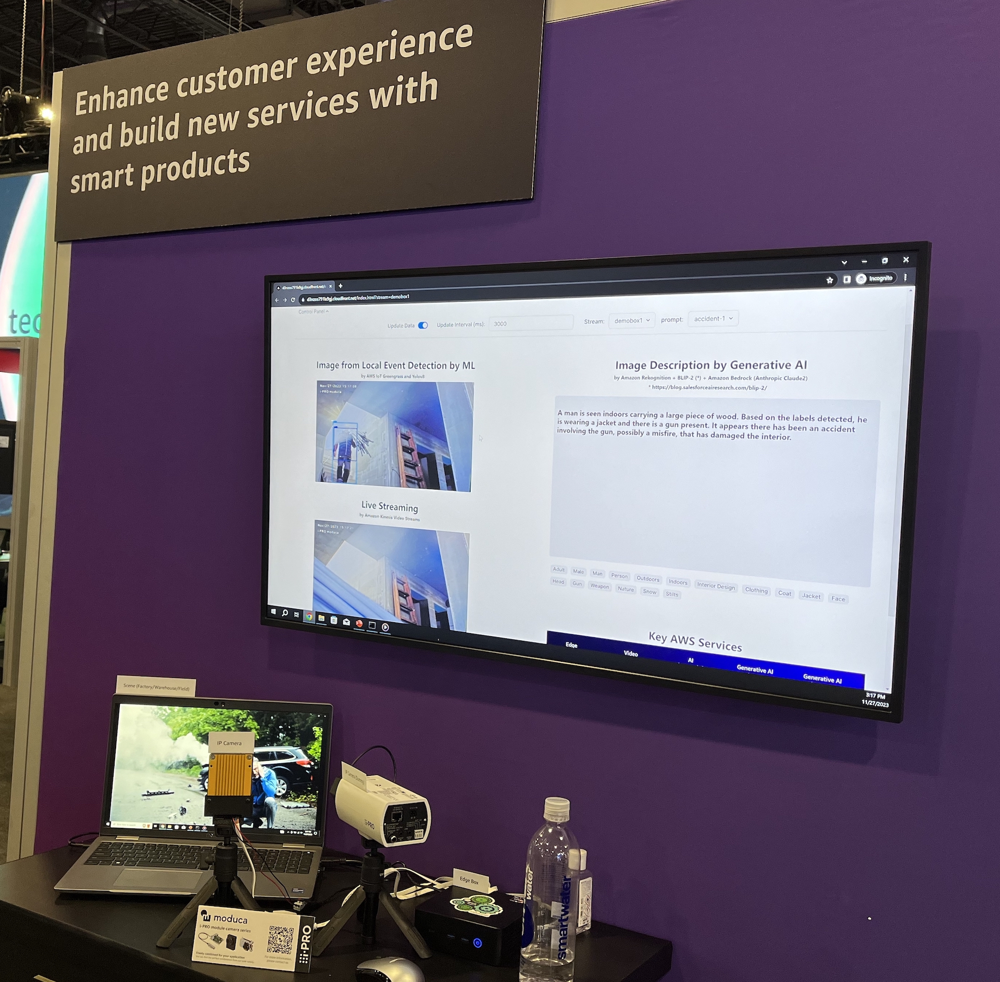
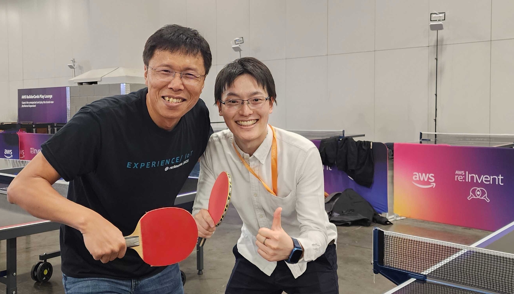

+++
title = "AWS re:Invent 2023 に参加してきました"
date = 2023-12-04T13:00:00+09:00
categories = [ "Career" ]
tags = []
+++

AWS re:Invent 2023 に社員として参加してきたので、その参加レポートです。

<!--more-->

2023年11月27日から12月1日にアメリカのラスベガスで開催された re:Invent に、昨年に引き続き参加してきました。

## 何をやってたの？

re:Invent では、主にロボティクス関係のハンズオンのサポートを行っていました。

AWS のハンズオンというとブラウザで完結できるイメージがあるかと思いますが、ロボティクスのハンズオンでは小型のロボットや IoT デバイスを使います。
そのため、実際にデバイスを動かそうとすると Wi-Fi や PC との相性の問題など、思わぬトラブルが発生することもしばしば。
ハンズオンセッションのメンバーは、前日からデバイスのセットアップを進め、セッション当日は参加者のトラブルや Q&A 対応を行いました。

ちなみに昨年は[実際のロボットを活用した登壇](https://www.wantedly.com/companies/seqsense/post_articles/466592)をしてきたりしたのですが、登壇者は re:Invent Speaker のバッジや特別なSWAG をもらえたりします。

また、EXPO というメインの展示会場で展示していた Industrial デモの開発にも携わりました。カメラで撮影された映像に対して LLM を活用して説明するようなデモになっています。

## re:Invent Tips

### ラスベガスの乾燥対策

ラスベガスは砂漠の真ん中にあるのでとても乾燥しており、対策が非常に重要になります。

私の場合は、例えば、[ペットボトルにつけられる加湿器](https://amzn.to/47Y9QJ6)を持っていったり、寝るときは必ずマスクをしたり、ハンドクリームやリップスティック、ボディミルクなどを持っていったりと、かなり念入りに対策をしました。
結構頑張って対策したと思うのですが、それでもやはり鼻の中がガビガビになったり、喉が痛くなったり、指先が荒れたりと、乾燥にはかなり苦しめられました。

また、ホテルに備え付けのシャンプーなどを使うと髪がゴワゴワになるので、[トラベル用のシャンプーセット](https://amzn.to/3uG67BM)も持参しました。
これはかなり成功で、髪がパサついたり肌がかゆくなったりすることなく、ラスベガスを乗り切ることができました。

### ホテル

ラスベガスでは Mandalay Bay に宿泊しました。
MGM の公式アプリを入れておくと、アプリから事前にチェックインができたり、スマホをカードキーとして使えたり、チェックアウトもウェブサイト上から行えたりと、非常に便利でした。
長旅で疲れたところに、チェックイン列に並ぶ必要がないのは非常に良いですね。
領収書もメールで送ってくれるので、経費精算もカンタンです。

### 会場間の移動

主要な会場間では re:Invent の専用シャトルバスが走っているので、無料で移動することができます。
しかし、時間帯によっては道路が混んでいて、例えば Mandalay Bay <-> Venetian 間では40分くらいかかることもありました。
また、ホテルの部屋からシャトルバスの乗り場 (Convention Center) が遠く、10〜15分くらいかかるのにも注意が必要です。

### 感染対策

飛行機ではマスクをしている方も多かったですが、ラスベガスや会場ではほとんどの方がマスクをしていませんでした。
もちろんマスクをしていても浮く感じはしないので、不安のある方はマスクをしておいたほうが良いかと思います。

## さいごに

Mandalay Bay には Rec Center という、屋内でスポーツを楽しめる会場があり、海外の同僚と一緒に卓球を楽しめました。
テックイベントというだけでなく、Fun の要素もあるところが re:Invent のいいところですね！

